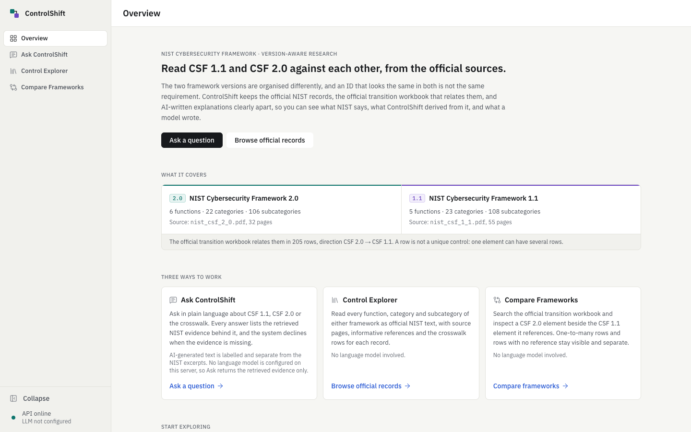
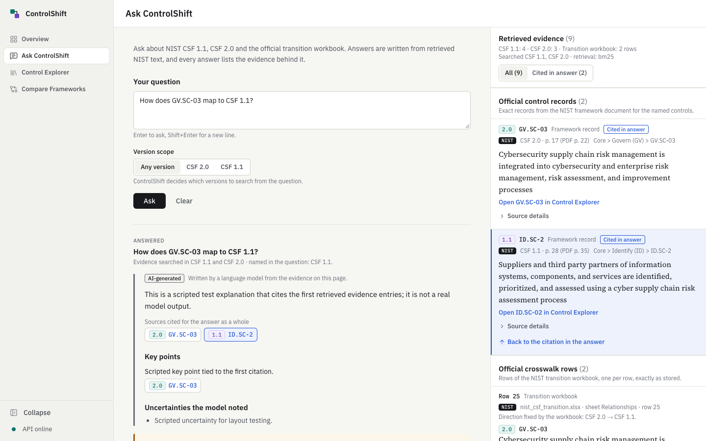
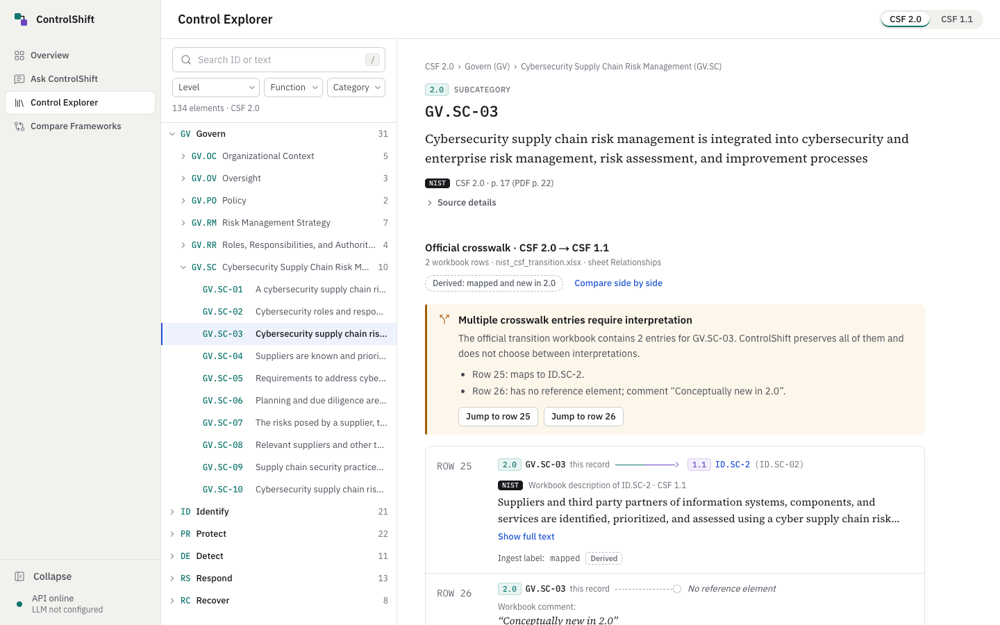
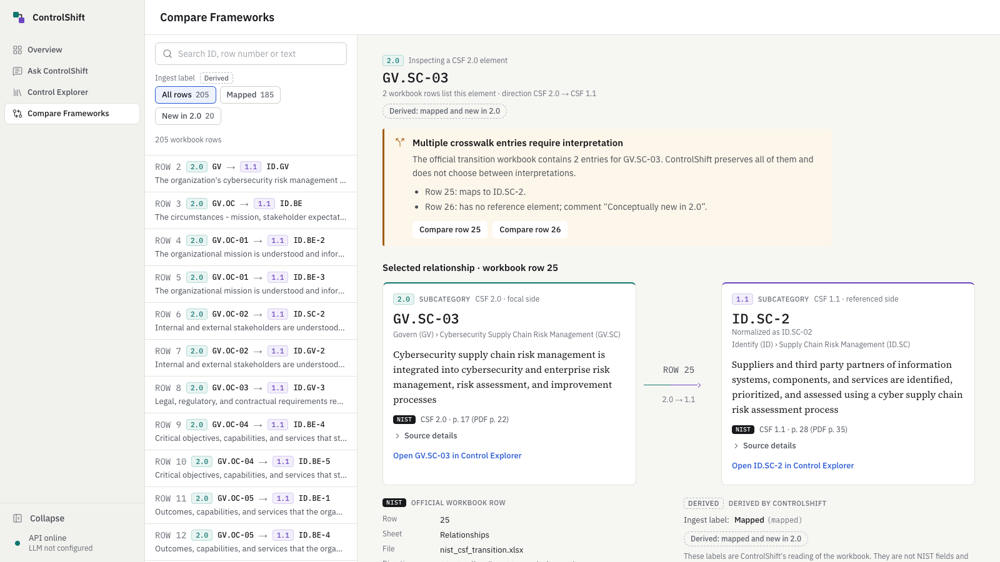
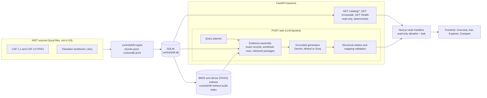

# ControlShift — Version-Aware Enterprise RAG over NIST CSF 1.1 and 2.0

ControlShift helps you compare the NIST Cybersecurity Framework 1.1 and 2.0 without losing track of what NIST actually says. It combines a SQLite store of the official framework records and the official transition workbook, hybrid retrieval, evidence-grounded answers with checked citations, and a web application that keeps **official NIST text**, **ControlShift-derived labels** and **AI-generated text** visibly apart.



## What makes it different from an ordinary RAG demo

- **Version-aware evidence, not a bag of chunks.** A query planner detects control IDs and framework versions; exact records come from SQLite, and passages come from retrieval per version, so a CSF 1.1 answer is not built from CSF 2.0 text by accident.
- **Official mappings are never inferred.** Relationships between 1.1 and 2.0 come only from the 205 rows of NIST's transition workbook, kept as individual rows (direction CSF 2.0 → CSF 1.1). Similarity search supplies passages, never mappings; a missing reference is never described as "removed".
- **Answers must cite, and may abstain.** Generation is constrained to a supplied evidence bundle; cited IDs must exist in it, mappings must match a cited workbook row, and unsupported "removed/deprecated" claims are rejected. With no usable evidence the system abstains instead of answering.
- **Honest verification limits.** Citation validation is **structural**: it proves the cited chunk or workbook row exists and its version, page, section and mapping endpoints match the database. It does **not** prove the answer's statements are faithful to the cited text, and no model confidence is reported.
- **Two deterministic workflows need no LLM at all** (Explorer and Compare), so the authoritative data is browsable on its own.
- **Evaluation evidence is kept, including failures** (see [Evaluation](#evaluation)).

> ControlShift is a portfolio/research project. It is not affiliated with or endorsed by NIST and has not been deployed.

## The three workflows

| | What it does | LLM |
|---|---|---|
| **Ask ControlShift** | Natural-language questions answered from retrieved NIST evidence. Citations are interactive and open an Evidence Inspector with source file, page, version and section. Outcomes: `answered`, `abstained`, `evidence_only` (no provider configured), `rejected` (answer failed validation, nothing shown). | Optional |
| **Control Explorer** | Browse and search every function, category and subcategory of both versions as verbatim NIST text, with provenance, informative references and the crosswalk rows for each record. | None |
| **Compare Frameworks** | Search the transition workbook (`GET /crosswalk`) and inspect a CSF 2.0 element beside the CSF 1.1 element(s) it references, forward and reverse. One-to-many rows and rows with no reference element stay separate; ControlShift's ingest labels are tagged *Derived*. | None |



*Illustrative test result: this answer was produced by a scripted fake LLM over real NIST retrieval to exercise the interface. It is not a verified live-model answer.*





## Architecture



Key decisions: SQLite is the source of truth for records and crosswalk rows; retrieval (BM25 + dense MiniLM fused with RRF, optional cross-encoder rerank) only finds passages; the generator sees a budgeted evidence context and its output is validated deterministically before anything is returned; the browser talks only to same-origin Next.js route handlers, which forward a fixed set of paths and never see provider keys.

## Quick start

Requirements: **Python 3.11+** (developed on 3.12) and **Node 20.9+** (developed on Node 26).

```bash
# 1. backend
python3 -m venv venv && source venv/bin/activate
pip install -e ".[dev]"          # full deps (downloads torch; large)
cp .env.example .env             # all optional; variables are listed under Deployment readiness

# 2. NIST data (not in Git): see "NIST source documents" below, then
controlshift-ingest && controlshift-db build && controlshift-db validate
controlshift-retrieve build-index                  # downloads all-MiniLM-L6-v2 on first run

# 3. run
controlshift-serve                                 # http://127.0.0.1:8000
cd frontend && npm ci && npm run dev               # http://localhost:3000
```

Without LLM credentials the API still works: Ask returns `evidence_only` and Explorer and Compare are unaffected. `RETRIEVAL_MODE=none` or `bm25` in `.env` avoids loading any model.

## NIST source documents

ControlShift needs three official NIST files, saved under these exact names in `data/raw/` (git-ignored; nothing from NIST is committed):

| Local filename | Official source |
|---|---|
| `nist_csf_1_1.pdf` | [The NIST Cybersecurity Framework 1.1 (CSWP 04162018)](https://nvlpubs.nist.gov/nistpubs/CSWP/NIST.CSWP.04162018.pdf) |
| `nist_csf_2_0.pdf` | [The NIST Cybersecurity Framework 2.0 (CSWP 29)](https://nvlpubs.nist.gov/nistpubs/CSWP/NIST.CSWP.29.pdf) |
| `nist_csf_transition.xlsx` | [CSFv1.1_to_CSFv2.0_CROSSWALK_20240220.xlsx](https://csrc.nist.gov/csrc/media/Projects/olir/documents/submissions/CSFv1.1_to_CSFv2.0_CROSSWALK_20240220.xlsx), the OLIR crosswalk linked from the [NIST CSF FAQ](https://www.nist.gov/cyberframework/faqs); the `Relationships` sheet (205 rows) is what ControlShift ingests |

These URLs were checked on 2026-10-23: files downloaded from them are byte-identical (SHA-256) to the files ControlShift was built and evaluated with (`data/processed/manifest.json` records the hashes of whatever you ingest, and the API exposes them in `/catalog/versions`). NIST may move files later; check the [CSF 2.0 resources](https://www.nist.gov/cyberframework/csf-20-resources) page if a link breaks.

*Attribution:* the framework text and workbook content shown by ControlShift come from NIST publications (NIST CSWP 29, NIST CSWP 04162018 and the NIST OLIR CSF 1.1 to 2.0 crosswalk). ControlShift is an independent project, **not affiliated with or endorsed by NIST**; see NIST's own terms for reuse of its content.

## Reference

### Ingestion

Place the three NIST files in `data/raw/` (`nist_csf_1_1.pdf`, `nist_csf_2_0.pdf`,
`nist_csf_transition.xlsx`), then:

```bash
controlshift-ingest            # writes data/processed/{chunks.jsonl,crosswalk.jsonl,manifest.json}
```

Ingestion needs only `pymupdf`, `pandas` and `openpyxl`. Source files and expected names: see *NIST source documents* above.

### Knowledge store

```bash
controlshift-db build      # data/processed/*.jsonl -> data/processed/controlshift.db
controlshift-db validate   # integrity + counts vs ingestion manifest
controlshift-db inspect
controlshift-db map GV.OC-01 --version 2.0     # forward (2.0 -> 1.1) official rows
controlshift-db map ID.BE-2 --version 1.1      # reverse lookup over the same rows
controlshift-db unmapped [--direction no-later|flagged-new] [--level subcategory]
```

### Retrieval

```bash
controlshift-retrieve build-index                  # downloads all-MiniLM-L6-v2 on first run
controlshift-retrieve search "GV.SC-03" --mode bm25
controlshift-retrieve search "protect data at rest" --mode dense --version 1.1
controlshift-retrieve search "manage supplier risk" --mode hybrid_rerank --debug   # bm25|dense|hybrid|hybrid_rerank
```

On macOS, dense search uses an exact NumPy product over the FAISS-stored vectors (faiss-cpu and torch ship
conflicting OpenMP runtimes); see `src/controlshift/retrieval/dense.py` and `--dense-backend`.

### Evidence bundles (no LLM)

```bash
controlshift-evidence "How does GV.SC-03 map to CSF 1.1?"            # JSON: records, official mappings, passages, citations
controlshift-evidence "What changed for supply chain risk management?" --retrieval bm25
```

### Grounded answers and API

```bash
cp .env.example .env              # set LLM_PROVIDER (gemini|mistral|groq) and that provider's API key and model to enable generation
controlshift-serve                # or: uvicorn controlshift.api.app:app_factory --factory
curl -s localhost:8000/health
curl -s localhost:8000/ask -H 'content-type: application/json' \
  -d '{"question": "How does GV.SC-03 map to CSF 1.1?"}'
curl -s localhost:8000/compare -H 'content-type: application/json' \
  -d '{"question": "supplier risk", "control_ids": ["GV.OC-01"]}'
```

**Live status.** A six-question exploratory live evaluation was run with Groq `qwen/qwen3.8-27b` as generator (Gemini returned repeated HTTP 503s and Mistral a 429; both remain
selectable). That is a small exploratory sample, **not an accuracy evaluation**, and ControlShift is not production-deployed. Without LLM credentials the API still works and returns
`status: "evidence_only"` with the full evidence bundle. Answers are validated (cited ids must exist in the supplied evidence, mappings must match official crosswalk rows), but citation checks are
structural: they do not prove the answer is faithful to the cited text, and no model confidence is reported.
The generator is chosen by `LLM_PROVIDER` (`gemini` is the default; `mistral` and `groq` — e.g. Qwen on Groq — are alternatives). The judge is configured separately (`JUDGE_PROVIDER`/`JUDGE_MODEL`, currently Groq `openai/gpt-oss-120b`) and never falls back to the generator.
A live-provider smoke test is opt-in: `RUN_LIVE_LLM_TESTS=1 GEMINI_API_KEY=... GEMINI_MODEL=... pytest tests/test_live_provider.py`.

## Evaluation

> **Exploratory, not an accuracy claim.** The retrieval benchmark uses 39 AI-labelled questions (chunk ranking only); the live-answer evaluation covers **six questions**; the LLM judge has **not** been validated against human reviewers and no independent human review was completed. Read [`eval/README.md`](eval/README.md) and `eval/final_evaluation_report.md` for what each artifact does and does not show. No figures are quoted here on purpose.

```bash
python eval/build_questions.py     # validates the curated labels against SQLite, writes eval/questions.jsonl + audit sheet
python eval/benchmark.py           # runs the 4 retrieval modes with the real models; writes eval/results.json + eval/report.md
```

```bash
python eval/build_answer_questions.py   # gold file for grounded-answer evaluation, verified against SQLite
python eval/answer_eval.py              # OFFLINE: evidence-stage checks + validator self-test; no LLM calls
```

`eval/answer_report.md` and `eval/answer_review_worksheet.md` separate structural checks, deterministic factual checks and
semantic faithfulness; the last is **pending human review** (nothing is scored yet). A live-Gemini mode exists but is disabled by
default (`--live` plus `RUN_LIVE_LLM_EVAL=1`) and has not been run.

```bash
python eval/judge_eval.py          # DRY RUN, 0 API calls: plan, calibration worksheet, report (generator/judge sections say "Not run")
```

An LLM-as-a-judge framework (faithfulness at claim level, relevance, factual correctness, completeness, citation support; plus an opt-in segmented mode for long answers) exists. In the six-question
exploratory run GPT-OSS judged four answers (A01, C01, E01, F01); the original B01 is unjudged and H02 is an abstention. Judge scores are opinions, not ground truth; generator and judge share Groq
infrastructure; and **the judge has not been validated against human reviewers** (no independent human review was completed). Live commands are in `PROGRESS.md`.

**Evaluation status.** Retrieval benchmark: `eval/report.md` (39 AI-labelled questions; chunk ranking only). Six-question live-answer evaluation, complete with documented limitations:
`eval/final_evaluation_report.md` (supporting: `eval/human_review_packet.md`, `eval/b01_before_after.md`, `eval/live_answer_review.md`; raw records in `eval/live_runs/` and `eval/failed_runs/`). Five of six original
answers passed every applicable deterministic check; the original B01 did not (a retrieval omission and a factual error), and its two post-hoc repairs are documented separately.

See `eval/report.md` for retrieval results and limitations. The relevance labels are AI-curated and source-checked, **not
human-reviewed**; review them in `eval/questions_audit.md`.

## Deployment readiness

ControlShift is two processes: the FastAPI backend (Python >= 3.11) and the Next.js frontend (Node >= 20.9; developed on Node 26). The browser only talks to the frontend; the frontend server proxies a fixed set of paths to the backend.

**Build from a clean checkout**

```bash
# backend
python3 -m venv venv && source venv/bin/activate && pip install -e .
# the three NIST files are NOT in the repository: place them in data/raw/ first (see Ingestion)
controlshift-ingest && controlshift-db build && controlshift-db validate
controlshift-retrieve build-index      # not needed for RETRIEVAL_MODE=none; downloads all-MiniLM-L6-v2 on first run
# frontend
cd frontend && npm ci && npm run build
```

`data/raw`, `data/processed`, `data/indexes`, `.env` and every `*.db` are git-ignored, so a deployment must produce (or mount) `data/processed/controlshift.db` and, for retrieval modes other than `none`, `data/indexes/` (about 2.5 MB together).

**Run**

```bash
# backend (reads .env; API_HOST defaults to 127.0.0.1, API_PORT to 8000)
controlshift-serve
# frontend (from frontend/)
CONTROLSHIFT_API_URL=http://127.0.0.1:8000 npm run start      # port 3000; PORT=... to change
```

**Configuration**

| Variable | Where | Meaning |
|---|---|---|
| `CONTROLSHIFT_API_URL` | frontend server | Backend base URL. Read at request time (not at build), never sent to the browser. Default `http://127.0.0.1:8000`. |
| `SQLITE_PATH`, `INDEX_DIR` | backend | Relative paths resolve against the backend's working directory: start it from the repository root or set absolute paths. |
| `RETRIEVAL_MODE` | backend | `none` (structured records only), `bm25` (index only, no model), `dense`, `hybrid` (default), `hybrid_rerank`. Dense and hybrid modes load sentence-transformers models at start-up, so the model cache must be available (first run downloads from Hugging Face). |
| `LLM_PROVIDER`, `<PROVIDER>_API_KEY`, `<PROVIDER>_MODEL` | backend | Optional. Without a configured provider `/ask` returns `evidence_only`. Keys live only in the backend environment (`.env` or the host's secret store); the frontend never receives them. |
| `API_HOST`, `API_PORT`, `LLM_TIMEOUT_SECONDS`, `REQUEST_TIMEOUT_SECONDS` | backend | Bind address (use `0.0.0.0` only behind a private network or proxy) and time limits (the frontend waits up to 100s for `/ask`). |

**Health and troubleshooting**

- `GET /health` on the backend (also `/api/backend/health` through the frontend) returns database counts, retrieval mode and `llm.configured`; the sidebar status reads it.
- Sidebar shows "API unreachable": check `CONTROLSHIFT_API_URL` and that `controlshift-serve` is running; the proxy answers 502 when it cannot reach the backend.
- Backend exits at start-up: a missing database ("run `controlshift-db build`"), a stale or missing index (`controlshift-retrieve build-index`), or a model that cannot be downloaded (use `RETRIEVAL_MODE=bm25` or `none`).
- Ask says "No language model is configured": expected without provider credentials.

**Constraints and concerns before a public deployment**

- **No authentication or rate limiting.** Anyone who can reach the frontend can call `POST /api/backend/ask`, which spends LLM provider credit when a provider is configured. Put the app behind access control or a rate limit first, and keep the backend (which also serves `/docs` and the LLM-backed `POST /compare`) on a private network; the frontend proxy forwards only `/ask` and the read-only catalog, crosswalk and health GETs.
- The backend loads its models and runs retrieval in one process (retrieval is serialised by a lock); run a single worker.
- NIST source files must be obtained separately; they are not distributed with the repository.
- Generation quality has only been explored on six questions (see the evaluation notes above); the UI never reports model confidence.
- `npm audit` shows development-only advisories (see `frontend/README.md`); `npm audit --omit=dev` is clean.

## Testing

- Backend: `pytest` (559 tests collected, a few opt-in or data-dependent ones skipped by default; no model downloads or network calls except opt-in live tests) and `ruff check .`. Several tests build the database from the real NIST files, so run ingestion first.
- Frontend (from `frontend/`): `npm test` (162 Vitest tests using recorded API fixtures), `npm run lint`, `npm run typecheck`, `npm run build`.
- The Ask interface was exercised in a browser against real NIST retrieval with a **scripted fake LLM**; live-model behaviour in the UI has not been tested.

## Limitations

- Citation checks are structural only; answer faithfulness is not verified automatically and no confidence score is produced.
- The evaluation below is a small exploratory sample, not an accuracy benchmark.
- No authentication or rate limiting; not production-deployed (see *Deployment readiness*).
- English-language NIST CSF 1.1 / 2.0 only; search in Explorer is substring matching, not semantic.
- Official crosswalk rows are shown as recorded; a row is not an assertion of perfect equivalence.

## Repository layout

- `src/controlshift/` - backend package (ingest, store, retrieval, evidence, generation, api, evaluation)
- `tests/` - backend test suite
- `frontend/` - Next.js web application (see `frontend/README.md`)
- `docs/` - `frontend-design-spec.md` (design reference) and `assets/` (README screenshots)
- `eval/` - evaluation scripts, results and reports (start at [`eval/README.md`](eval/README.md))
- `data/raw/` - where you place the NIST files (git-ignored)
- `PROGRESS.md` - the project's running development log, milestone by milestone
- `CLAUDE.md` - working instructions for Claude Code, the AI coding assistant used throughout development

**AI-assisted development.** ControlShift was built with Claude Code under the direction and review of the repository owner. `CLAUDE.md` and `PROGRESS.md` are kept in the repository for transparency.
